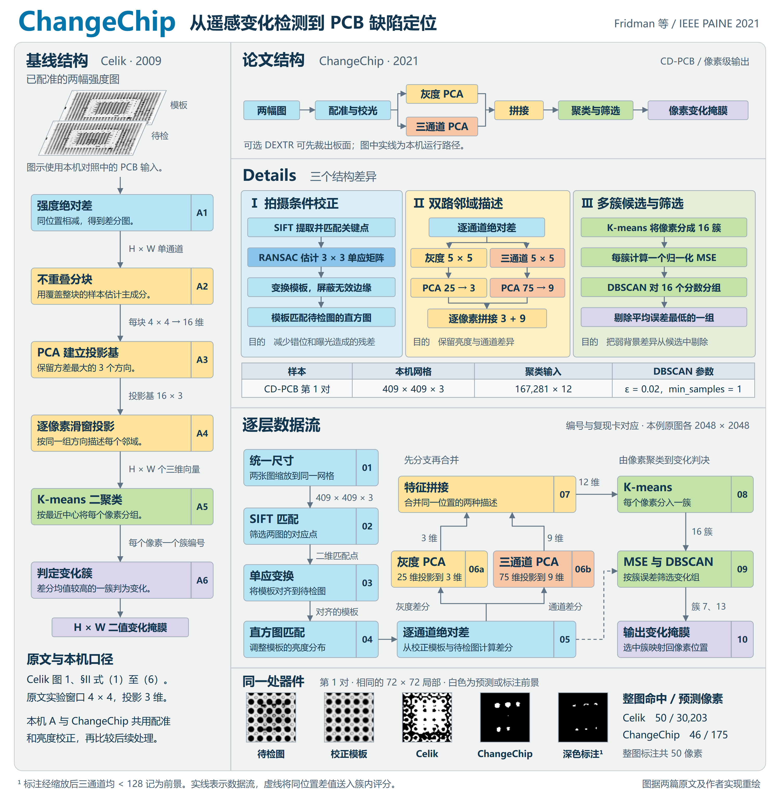

# ChangeChip 论文框架与复现

Fridman、Rusanovsky、Oren，*ChangeChip: A Reference-Based Unsupervised Change Detection for PCB Defect Detection*，IEEE PAINE 2021，arXiv:2109.05746。该工作用一张正常模板定位待检 PCB 上发生变化的像素。它是本项目的双图方法参考；DeepPCB 六类水平框检测另有对应的论文与计分协议。[原文图 1、§III 和 §IV.C](https://arxiv.org/html/2109.05746v1) · [作者提交](https://github.com/Scientific-Computing-Lab/ChangeChip/tree/1c3281fabc009fc46a4a11c4c49441992fe22352)

**任务**是给定正常模板与待检 PCB，输出二值变化掩膜。**结构基线**取作者在 §II、§III.B 和参考文献 21 明确借鉴的 Celik（2009）PCA–K-means。这里关心的问题是，两图已经对齐后，改用双路特征、多簇划分和簇筛选，能减少多少误报，又会漏掉多少变化像素？两篇论文的图 1 分别给出各自流程。ChangeChip 的 §IV.C 给出完整方法的像素精确率与召回率，没有列出 Celik 在 CD-PCB 上的对照数值。[Celik 原文 §II、图 1、式（1）至（6）](https://doi.org/10.1109/LGRS.2009.2025059) · [ChangeChip 原文](https://arxiv.org/html/2109.05746v1)



[放大或编辑框架图](framework.svg) · [作者原始流程图](https://github.com/Scientific-Computing-Lab/ChangeChip/blob/1c3281fabc009fc46a4a11c4c49441992fe22352/workflow.PNG)

## 基线结构与论文改动

从图的左侧向下读 Celik。A1 对两幅已配准的强度图逐像素取绝对差。A2 把差分图切成不重叠的块，A3 用这些块估计 PCA 投影基。A4 再把每个像素周围的滑动窗口投影到同一组方向。A5 将向量聚成两簇，A6 计算每簇在差分图上的平均强度，将均值较高簇的像素标为变化。原文实验用 4 × 4 窗口和 3 个主成分。[Celik §II–III](https://doi.org/10.1109/LGRS.2009.2025059)

| 位置 | 基线 → ChangeChip | 为什么可能改善 PCB 检测 | 哪些条件限制这个解释 |
|---|---|---|---|
| 计算差分前（01–04） | Celik 要求输入已对齐。ChangeChip 把对应点匹配、模板配准和直方图匹配纳入流程，还可裁出板面。 | 同一焊盘若在两次拍摄中错开几个像素，即使完好，直接相减也会亮出两圈边缘。先对齐再相减可减少这种误报；匹配亮度分布可减弱整体曝光偏差。 | 单个平面变换难以补偿凸起元件的视差。本机两组共用校正，该对照不能估计校正的独立收益。 |
| 邻域特征（05–07） | 单路 4 × 4 强度差、3 维 → 灰度与三通道两路 5 × 5 差分，拼接为 12 维。 | 彩色板上，两处颜色可能亮度相近。三通道分支可保留被压成灰度后减弱的通道差异。 | 第 1 对原图为灰度，三通道读入不会产生新的颜色信息。窗口、维数和分支同时改变，无法单独归因给颜色。 |
| 变化判决（08–10） | 两簇直接判定 → 先把像素分成 16 簇，再按每簇 MSE 分组，丢弃平均误差最低的一组。 | 当重复焊点边缘产生大量微弱差异时，二分法会把其中一部分和真实变化混在一起。多簇给强弱差异更多分离空间，低误差组可整体剔除。 | 弱缺陷也可能落入被剔除的组。第 1 对中，基线命中 50 个深色标注像素，ChangeChip 命中 46 个。 |

全局几何配准和亮度校正在 ChangeChip §III.A 已有明确先例。可以把它们作为后续工作的基线组件；本次复现中的实现与结果属于对已有方法的核验。[ChangeChip §III.A–C、§V](https://arxiv.org/html/2109.05746v1)

## 按编号读论文结构

从右下方 01 沿箭头读到 10。05 分成两路，07 再合并，09 同时读取簇编号和像素差值。图底部截取 CD-PCB 第 1 对同一处 72 × 72 区域；右侧命中数与预测数按整幅图统计。第 1 对原图为灰度文件，作者程序按三通道读入。以下尺寸取自这对图，其他样本随输入大小变化。

| 编号与模块 | 这一层解决什么问题 | 本例输出 |
|---|---|---|
| 01　统一尺寸 | 将待检图和模板缩放到相同网格，以便比较同一位置。 | 两幅 409 × 409 × 3 图像 |
| 02　SIFT 匹配 | 寻找两图中对应的板面纹理，通过最近邻与次近邻的距离比筛选匹配。 | 两图中成对的二维坐标 |
| 03　单应变换 | 用 RANSAC 从匹配点估计几何映射，将模板变换到待检图的坐标系。两图的无效边缘同步置零。 | 3 × 3 单应矩阵、对齐后的模板 |
| 04　直方图匹配 | 让模板的亮度分布接近待检图，减少光照差异对后续差分的干扰。 | 409 × 409 × 3 校正后模板 |
| 05　逐通道绝对差 | 比较同一位置、同一通道的像素强度，得到三通道差分及其灰度表示。差值也用于第 09 步的簇评分。 | 三通道差分和单通道灰度差分 |
| 06a　灰度分支 | 取每个像素周边 5 × 5 个灰度差值，用 PCA 压缩亮暗变化的局部模式。 | 每个像素 25 → 3 维 |
| 06b　三通道分支 | 分别读取三个通道的 5 × 5 差分窗口，保留通道之间的区别，再做 PCA。 | 每个像素 75 → 9 维 |
| 07　特征拼接 | 合并同一位置的两种描述，让后续聚类同时利用两路信息。 | 167,281 个像素，每个 12 维 |
| 08　K-means | 将差分模式相似的像素聚在一起，给每个像素分配一个簇编号。 | 409 × 409 的编号图，共 16 簇 |
| 09　MSE 与 DBSCAN | 计算每个簇中两图像素差的归一化均方误差，再对这 16 个分数分组。排除平均误差最低的一组，保留其余组。 | 本例保留簇 7、13 |
| 10　变化掩膜 | 将所选簇编号映射回像素位置。图中白色掩膜由作者保存的簇图与保留编号生成。 | 409 × 409 掩膜，175 个预测变化像素 |

实现位置见作者的[配准代码](https://github.com/Scientific-Computing-Lab/ChangeChip/blob/1c3281fabc009fc46a4a11c4c49441992fe22352/registration.py)、[差分与聚类代码](https://github.com/Scientific-Computing-Lab/ChangeChip/blob/1c3281fabc009fc46a4a11c4c49441992fe22352/PCA_Kmeans.py)和[总入口](https://github.com/Scientific-Computing-Lab/ChangeChip/blob/1c3281fabc009fc46a4a11c4c49441992fe22352/main.py)。

## 复现范围与结果

| 项目 | 记录 |
|---|---|
| 原文结果 | §IV.C，CD-PCB 共 20 对，像素精确率 P = 0.80、召回率 R = 0.87。原文图 5 是定性示例。 |
| 作者发布内容 | 算法源码、数据包入口和示例。主流程无需预训练权重，DEXTR 权重用于可选裁切。 |
| 本机输入 | 逐项核对发布压缩包。第 1、2、4、5、11、18、19、20 对同时有待检图、模板、标注。其余 12 个目录缺至少一幅输入图。 |
| 运行设置 | 逐对处理，`seed=0`、缩放 0.2、窗口 5、PCA 维数 3/9、K-means 16 簇；开启配准、亮度匹配，关闭可选裁切。沿用发布代码 `eps=0.02`，原文对射线图另报 0.05。 |
| 本机结果 | 8 对合计 5,025,660 像素，选中 945 个变化像素。按作者脚本的纯白前景规则，逐图等权 P/R 为 11.63% / 0.0080%。按发布标注中的稀疏深色像素计前景，逐图等权 P/R 为 75.37% / 87.24%。 |
| 证据等级 | **仅代码可运行，已完成 8 对子集实测**。数据覆盖和前景定义都影响比较。接近 0.87 的子集召回率不足以确认论文 20 对结果。 |

[8 对逐图数据](../../../outputs/reproduction/changechip/per_pair.csv) · [第 1 对作者程序输出](../../../outputs/reproduction/changechip/pair_1/ACCEPTED_CLASSES.png) · [两种计分口径及兼容适配](../../reproduction.md)

## 同一批图上的基线对照

按 Celik 原文重写其光学强度图算法，接在 ChangeChip 的预处理之后。两组使用同一批 8 对、同一缩放、配准、亮度校正和计分函数。计算基线时直接使用内存中的图像，并逐对核对作者代码导出的校正模板与既存复现文件字节一致。基线沿用原文的 4 × 4、3 维、两簇；本机取边缘复制补齐滑窗，K-means 固定种子 0、`n_init=10`。这是把 Celik 迁移到 PCB 的本机对照。原作者的遥感数据结果和本次固定种子的结果各有独立口径。[基线实现](../../../pcb_reference/reproduction/celik/__main__.py) · [Celik 逐图数据](../../../outputs/reproduction/celik/per_pair.csv) · [ChangeChip 逐图数据](../../../outputs/reproduction/changechip/per_pair.csv)

| 方法 | 预测变化像素 | 命中 / 误报 / 漏报（深色标注） | 逐图等权 P / R（深色标注） | 逐图等权 P / R（作者纯白前景） |
|---|---:|---:|---:|---:|
| Celik 结构基线，共用校正 | 643,407 | 784 / 642,623 / 86 | 10.02% / 96.20% | 88.06% / 13.44% |
| ChangeChip 作者实现 | 945 | 664 / 281 / 206 | 75.37% / 87.24% | 11.63% / 0.0080% |

这里比较的是 5,025,660 个像素，缩放后共有 870 个深色标注像素。按这种前景解释，ChangeChip 在全部 8 对上的预测都更精确，合计减少 642,342 个误报，同时少命中 120 个标注像素。第 11 对展示了代价：283 个标注像素中，Celik 命中 197 个，ChangeChip 命中 111 个。作者脚本把纯白像素算作前景，会把大面积白底计入真值，表中最后一列因此呈现不同结果。这批证据支持双路特征和多簇筛选组合在深色标注口径下更保守；各模块的独立贡献、其他数据上的收益及随机种子间波动均待测。

## 复跑命令

在项目根目录运行。输入目录为 `data/cdpcb/CD-PCB`，作者源码位于 `data/ChangeChip`。`--output` 可指定独立目录以比较两次结果。

```powershell
$py = 'C:\Users\BaiRong-NUC\.conda\envs\yolo\python.exe'
& $py -m pcb_reference.reproduction.changechip
& $py -m pcb_reference.reproduction.celik
```
